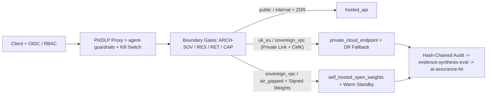
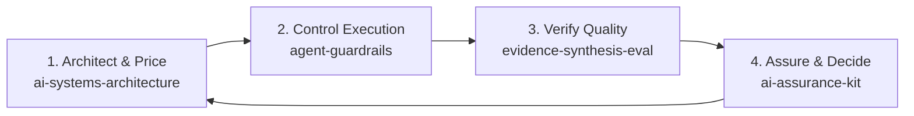

# ai-systems-architecture

[](https://github.com/dsugurtuna/ai-systems-architecture/actions/workflows/ci.yml)

[](LICENSE)

Architectural blueprints, deterministic deployment & security gates, target-architecture diagrams, executive ADRs, and total-cost-of-ownership (TCO) sensitivity economics for enterprise and regulated AI deployments.

> **Illustrative parameters.** All workloads, token prices, latencies, capacities, and error rates in `examples/` are synthetic benchmark assumptions designed to surface architectural trade-offs, not live vendor quotes or production telemetry.

## The problem

Enterprise AI architecture choices routinely go wrong in three predictable ways:

1. **Ignoring deployment and failover boundaries until late in delivery.** A design looks cheap and fast on a multi-tenant public API, only to fail residency (`uk_eu`, `sovereign_vpc`, `air_gapped`), zero-data-retention, tool-calling parity, or standby-fallback checks right before go-live.
2. **Pricing tokens in isolation.** Comparing `£ / 1M tokens` distorts routing decisions in both directions: high-judgement tasks underprice human checking (`review_rate_multiplier`) and downstream rework when routed to weaker models, while high-volume structured workloads overpay hosted token fees instead of amortising a multi-AZ open-weights cluster or sequential cascade.
3. **Treating point estimates as robust decisions.** Without break-even volume sweeps, capacity ceilings (`max_monthly_tokens`), and error-rate tipping points, teams miss how narrow a TCO lead actually is.

This package makes those architectural trade-offs explicit, deterministic, and testable in CI.

## Reference trust-boundary & failover topology

All routing options are evaluated across `primary_model`, `escalation_model`, and `fallback_model` so failover never degrades sovereignty, retention, or tool-calling guarantees:



Full C4-style deployment boundary topology and sequential-cascade failover sequence diagrams: [docs/diagrams/architecture-boundaries.md](docs/diagrams/architecture-boundaries.md).

## How it fits in the stack



- **Here (`ai-systems-architecture`):** Validates data residency, zero-data-retention, fallback parity, tool-calling capability, token capacity ceilings, SLA latency, security controls, full unit economics, and break-even sensitivity across candidate routing options.
- **Runtime ([`agent-guardrails`](https://github.com/dsugurtuna/agent-guardrails)):** Enforces allow/draft/approve modes, execution-time re-validation, idempotency, hash-chained audit logs, and kill switches on state-changing tool calls.
- **Evaluation ([`evidence-synthesis-eval`](https://github.com/dsugurtuna/evidence-synthesis-eval)):** Measures faithfulness, coverage, misstatements, blinded human-judge agreement, and human checking cost on UK AISI Inspect.
- **Assurance ([`ai-assurance-kit`](https://github.com/dsugurtuna/ai-assurance-kit)):** Turns use cases into schema-validated YAML governance records, 26 explainable risk checks, and executive cards.

## Quickstart

Needs Python 3.11 or later. Runs completely offline with zero API keys.

```bash
git clone https://github.com/dsugurtuna/ai-systems-architecture.git
cd ai-systems-architecture
python3.11 -m venv .venv && source .venv/bin/activate
pip install -e ".[dev]"
pytest
```

Run architecture gate checks, TCO routing briefs, and break-even sensitivity analysis on the bundled blueprints:

```bash
aiarch validate examples/*.yaml
aiarch check examples/sovereign-defence-briefing.yaml --fail-on high
aiarch economics examples/sovereign-defence-briefing.yaml
aiarch sensitivity examples/high-volume-document-triage.yaml
aiarch compare examples/
```

Real output of `aiarch economics examples/sovereign-defence-briefing.yaml`:

```text
# Architecture Brief: Sovereign Intelligence Briefing Synthesis

**Workload:** `sovereign-briefing-01` | **Domain:** Sovereign & Defence Operations | **Volume:** 25,000 req/mo (4,500 in / 900 out tokens)
**Posture:** sensitivity=`restricted_sovereign`, residency=`sovereign_vpc`, action=`draft_only`, SLA p95=4500 ms

| Option | Deployment | Inference/mo | Review + Rework/mo | Total/mo | Net Savings/mo | p95 (ms) | Gates |
|---|---|---:|---:|---:|---:|---:|---|
| Public Hosted Frontier (Unconstrained) | `hosted_api` | £450.00 | £46,958.33 | £47,408.33 | £32,591.67 | 2100 | BLOCKED (2 high, 1 warn) |
| Sovereign VPC Private Endpoint + Standby | `private_cloud_endpoint` | £4,790.28 | £46,958.33 | £51,748.61 | £28,251.39 | 2400 | PASS |
| Self-Hosted Open-Weights Cluster + Standby | `self_hosted_open_weights` | £10,236.56 | £72,697.92 | £82,934.48 | £-2,934.48 | 1900 | PASS (1 warn) |

**Recommendation:** `opt-sovereign-endpoint` (Sovereign VPC Private Endpoint + Standby) — £51,748.61/mo total (£2.0699/task, net savings £28,251.39/mo, inference 9.3% vs human effort 90.7%).

## Gate Findings

- **HIGH** `ARCH-SOV-001` [opt-public-api] **Confidential, sovereign, or air-gapped workload routed via hosted API** — Option 'opt-public-api' includes hosted_api model(s) public-frontier-api, violating ADR-001 boundary for 'restricted_sovereign' / 'sovereign_vpc'.
- **HIGH** `ARCH-RES-001` [opt-public-api] **Model residency does not satisfy workload residency requirement** — Required residency 'sovereign_vpc' is not supported by model(s): public-frontier-api.
- **WARNING** `ARCH-REL-001` [opt-public-api] **No fallback model configured for high-volume or sovereign workload** — Option 'opt-public-api' has no fallback_model; single-provider or single-cluster outages will interrupt service.
- **WARNING** `ARCH-ECO-001` [opt-self-hosted] **Negative net ROI once human verification and rework are priced** — Option 'opt-self-hosted' totals GBP 82,934.48/mo vs baseline GBP 80,000.00/mo (net GBP -2,934.48/mo).
```

To see the opposite regime and sensitivity envelope, run `aiarch sensitivity examples/high-volume-document-triage.yaml` (`1,600,000` req/mo):

Real output of `aiarch sensitivity examples/high-volume-document-triage.yaml`:

```text
# Sensitivity Analysis: High-Volume Regulated Document Triage & Extraction

**Workload:** `high-vol-doc-triage-04` | **Current Volume:** 1,600,000 req/mo
**Comparison:** `opt-self-hosted-open` (£137,900.00/mo) vs `opt-private-frontier` (£142,781.20/mo) — margin **£4,881.20/mo** (3.4%)

## Key Tipping Points

- **Break-even volume:** **885,539 req/mo** (`opt-self-hosted-open` is cheaper above this threshold)
- **Blended error-rate tolerance:** `+0.000153` (`+0.0153` percentage points) (tipping blended error rate: 0.2953%)
- **Primary model error-rate tolerance:** `+0.000153` (`+0.0153` percentage points) (tipping primary error rate: 0.2953%)

## Volume Sweep

| Volume (req/mo) | `opt-self-hosted-open`/mo | `opt-private-frontier`/mo | Margin/mo | Recommended | Capacity Alerts |
|---:|---:|---:|---:|---|---|
| 400,000 | £39,200.00 | £35,882.80 | £-3,317.20 | `opt-private-frontier` | - |
| 800,000 | £72,100.00 | £71,515.60 | £-584.40 | `opt-private-frontier` | - |
| 885,539 (break-even) | £79,135.58 | £79,135.59 | £0.01 | `opt-self-hosted-open` | - |
| 1,600,000 (current) | £137,900.00 | £142,781.20 | £4,881.20 | `opt-self-hosted-open` | - |
| 3,200,000 | £269,500.00 | £285,312.40 | £15,812.40 | `opt-self-hosted-open` | opt-self-hosted-open |
| 8,000,000 | £664,300.00 | £712,906.00 | £48,606.00 | `opt-self-hosted-open` | opt-self-hosted-open |
```

`regulated-financial-risk-triage.yaml` illustrates the hybrid middle ground where an 85/15 open-weights-to-frontier `sequential_cascade` wins above `254,073 req/mo`, while `scientific-evidence-copilot.yaml` shows a `pre_router` rescuing net ROI from a `-£23,746/mo` unverified small-model rework trap.

## Deterministic architecture gates

| Rule ID | Severity | What it catches |
|---|---|---|
| `ARCH-SOV-001` | `high` | `confidential`, `restricted_sovereign`, or `air_gapped` workload routed via `hosted_api` (primary, escalation, or fallback) |
| `ARCH-SOV-002` | `high` | `air_gapped` workload referencing any non-`self_hosted_open_weights` model |
| `ARCH-RES-001` | `high` | Workload residency (`uk_eu`, `sovereign_vpc`, `air_gapped`) unsupported by any participating model |
| `ARCH-RET-001` | `high` | Non-`public` workload (`internal`, `confidential`, `restricted_sovereign`) routed without `zero_data_retention: true` |
| `ARCH-CAP-001` | `high` | `writes_with_approval` or `autonomous` workload routing to a model with `supports_tool_calling: false` |
| `ARCH-SEC-001` | `high` | `writes_with_approval` or `autonomous` action profile missing `runtime_guardrails` or `kill_switch_enabled` |
| `ARCH-SEC-002` | `high` | `confidential` or `restricted_sovereign` workload missing `egress_restricted` or `audit_log_enabled` |
| `ARCH-SEC-003` | `high` | Sensitive workload disabling `cmk_encryption` / `workload_identity_rbac` / `pii_redaction_proxy`, or self-hosted option with `signed_artifact_provenance: false` |
| `ARCH-CAP-002` | `warning` | Routed monthly token volume exceeding declared `max_monthly_tokens` on any active model |
| `ARCH-LAT-001` | `warning` | Smooth mixture p95 latency exceeding workload `p95_latency_sla_ms` |
| `ARCH-REL-001` | `warning` | High-volume (`>= 10,000` req/mo) or sovereign option missing a distinct `fallback_model` |
| `ARCH-EVAL-001` | `warning` | Blueprint missing pre-release `eval_gate_enabled` |
| `ARCH-ECO-001` | `warning` | Negative net ROI once inference, ops, standby, human verification, and rework costs are included |

## Architecture Decision Records (ADRs) & Diagrams

- [Reference Architecture & Failover Diagrams](docs/diagrams/architecture-boundaries.md)
- [ADR-001: Sovereign, Private VPC, and Hosted API Deployment Boundaries](docs/adrs/ADR-001-sovereign-vs-hosted-deployment.md)
- [ADR-002: Tiered Model Routing and Total Cost of Ownership (TCO)](docs/adrs/ADR-002-tiered-model-routing-and-tco.md)
- [ADR-003: Agentic Trust Boundaries and Execution Fail-Safes](docs/adrs/ADR-003-agentic-trust-boundaries.md)
- [ADR-004: Connecting Architecture, Runtime Controls, Evaluation, and Assurance](docs/adrs/ADR-004-end-to-end-release-gates.md)

Design choices and trade-offs are documented in [docs/WHY.md](docs/WHY.md).

## Scope and limitations

- Models deterministic blueprint assumptions rather than live network probing or real-time vendor pricing APIs.
- Explicit `routing_mode` differentiates `sequential_cascade` (`1.0` primary execution + `r` escalation, slow-path latency `primary + escalation`) from `pre_router` (`1 - r` primary + `r` escalation). Blended `p95_latency_ms` uses a continuous Weibull(`k=3`) mixture quantile so sensitivity sweeps remain smooth without threshold cliffs; `escaped_error_rate` and `review_minutes_per_item` should be calibrated from real evaluation runs before locking commercial commitments.
- Passing all deterministic gates verifies blueprint consistency, not underlying infrastructure hardening or penetration-testing evidence.

## Development

```bash
pip install -e ".[dev]"
pytest
ruff check . && ruff format --check .
mypy
```

## Licence

Apache License 2.0. See [LICENSE](LICENSE).

---

<sub>Personal project by [Ugur Tuna](https://github.com/dsugurtuna). Illustrative parameters only; views are my own.</sub>
