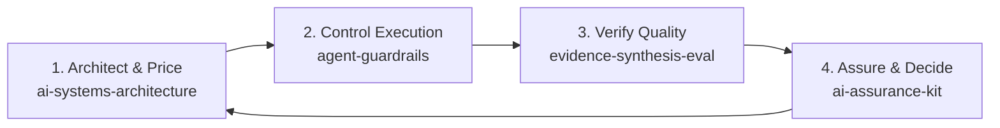

# ai-systems-architecture

[](https://github.com/dsugurtuna/ai-systems-architecture/actions/workflows/ci.yml)

[](LICENSE)

Architectural blueprints, deterministic sovereignty & security gates, executive ADRs, and total-cost-of-ownership (TCO) routing economics for enterprise and sovereign AI deployments.

> **Illustrative parameters.** All workloads, token prices, latencies, and error rates in `examples/` are synthetic benchmark assumptions designed to surface architectural trade-offs, not live vendor quotes or production telemetry.

## The problem

Enterprise and sovereign AI architecture choices routinely go wrong in two predictable ways:

1. **Ignoring deployment boundaries until late in delivery.** A design looks cheap and fast on a multi-tenant public API, only to fail residency (`uk_eu`, `sovereign_vpc`, `air_gapped`), zero-data-retention, or failover parity reviews right before go-live.
2. **Pricing tokens instead of total system economics.** Comparing `£ / 1M tokens` hides the real cost drivers: human verification minutes, downstream rework from escaped errors, dedicated GPU cluster overhead, and fallback resilience.

This package makes those architectural trade-offs explicit, deterministic, and testable in CI.

## How it fits in the stack



- **Here (`ai-systems-architecture`):** Validates data residency, zero-data-retention, fallback parity, SLA latency, security controls, and full unit economics (inference + human checking + rework) across candidate routing options.
- **Runtime ([`agent-guardrails`](https://github.com/dsugurtuna/agent-guardrails)):** Enforces allow/draft/approve modes, execution-time re-validation, idempotency, hash-chained audit logs, and kill switches on state-changing tool calls.
- **Evaluation ([`evidence-synthesis-eval`](https://github.com/dsugurtuna/evidence-synthesis-eval)):** Measures faithfulness, coverage, misstatements, blinded human-judge agreement, and human checking cost on UK AISI Inspect.
- **Assurance ([`ai-assurance-kit`](https://github.com/dsugurtuna/ai-assurance-kit)):** Turns use cases into schema-validated YAML governance records, 26 explainable risk checks, and executive cards.

## Quickstart

Needs Python 3.11 or later. Runs completely offline with zero API keys.

```bash
git clone https://github.com/dsugurtuna/ai-systems-architecture.git
cd ai-systems-architecture
python3.11 -m venv .venv && source .venv/bin/activate
pip install -e ".[dev]"
pytest
```

Run architecture gate checks and TCO routing briefs on the bundled blueprints:

```bash
aiarch validate examples/*.yaml
aiarch check examples/sovereign-defence-briefing.yaml --fail-on high
aiarch economics examples/sovereign-defence-briefing.yaml
aiarch compare examples/
```

Real output of `aiarch economics examples/sovereign-defence-briefing.yaml`:

```text
# Architecture Brief: Sovereign Intelligence Briefing Synthesis

**Workload:** `sovereign-briefing-01` | **Domain:** Sovereign & Defence Operations | **Volume:** 25,000 req/mo (4,500 in / 900 out tokens)
**Posture:** sensitivity=`restricted_sovereign`, residency=`sovereign_vpc`, action=`draft_only`, SLA p95=4500 ms

| Option | Deployment | Inference/mo | Review + Rework/mo | Total/mo | Net Savings/mo | p95 (ms) | Gates |
|---|---|---:|---:|---:|---:|---:|---|
| Public Hosted Frontier (Unconstrained) | `hosted_api` | £450.00 | £46,958.33 | £47,408.33 | £32,591.67 | 2100 | BLOCKED (2 high, 1 warn) |
| Sovereign VPC Private Endpoint + Standby | `private_cloud_endpoint` | £4,540.28 | £46,958.33 | £51,498.61 | £28,501.39 | 2400 | PASS |
| Self-Hosted Open-Weights Cluster + Standby | `self_hosted_open_weights` | £9,336.56 | £67,958.33 | £77,294.90 | £2,705.10 | 1900 | PASS |

**Recommendation:** `opt-sovereign-endpoint` (Sovereign VPC Private Endpoint + Standby) — £51,498.61/mo total (£2.0599/task, net savings £28,501.39/mo, inference 8.8% vs human effort 91.2%).

## Gate Findings

- **HIGH** `ARCH-SOV-001` [opt-public-api] **Sovereign or air-gapped workload routed via public hosted API** — Option 'opt-public-api' includes hosted_api model(s) public-frontier-api, violating sovereign/air-gapped isolation.
- **HIGH** `ARCH-RES-001` [opt-public-api] **Model residency does not satisfy workload residency requirement** — Required residency 'sovereign_vpc' is not supported by model(s): public-frontier-api.
- **WARNING** `ARCH-REL-001` [opt-public-api] **No fallback model configured for high-volume or sovereign workload** — Option 'opt-public-api' has no fallback_model; single-provider or single-cluster outages will interrupt service.
```

## Deterministic architecture gates

| Rule ID | Severity | What it catches |
|---|---|---|
| `ARCH-SOV-001` | `high` | `restricted_sovereign` or `air_gapped` workload routed to a `hosted_api` model (primary, escalation, or fallback) |
| `ARCH-SOV-002` | `high` | `air_gapped` workload referencing any non-`self_hosted_open_weights` model |
| `ARCH-RES-001` | `high` | Workload residency (`uk_eu`, `sovereign_vpc`, `air_gapped`) unsupported by any participating model |
| `ARCH-RET-001` | `high` | `confidential` or `restricted_sovereign` workload routed without `zero_data_retention: true` |
| `ARCH-SEC-001` | `high` | `writes_with_approval` or `autonomous` action profile missing `runtime_guardrails` or `kill_switch_enabled` |
| `ARCH-SEC-002` | `high` | Sensitive workload missing `egress_restricted` or `audit_log_enabled` |
| `ARCH-LAT-001` | `warning` | Blended/sequential p95 latency exceeding workload `p95_latency_sla_ms` |
| `ARCH-REL-001` | `warning` | High-volume (`>= 10,000` req/mo) or sovereign option missing a `fallback_model` |
| `ARCH-EVAL-001` | `warning` | Blueprint missing pre-release `eval_gate_enabled` |
| `ARCH-ECO-001` | `warning` | Negative net ROI once human verification and rework costs are included |

## Architecture Decision Records (ADRs)

- [ADR-001: Sovereign, Private VPC, and Hosted API Deployment Boundaries](docs/adrs/ADR-001-sovereign-vs-hosted-deployment.md)
- [ADR-002: Tiered Model Routing and Total Cost of Ownership (TCO)](docs/adrs/ADR-002-tiered-model-routing-and-tco.md)
- [ADR-003: Agentic Trust Boundaries and Execution Fail-Safes](docs/adrs/ADR-003-agentic-trust-boundaries.md)
- [ADR-004: Connecting Architecture, Runtime Controls, Evaluation, and Assurance](docs/adrs/ADR-004-end-to-end-release-gates.md)

Design choices and trade-offs are documented in [docs/WHY.md](docs/WHY.md).

## Scope and limitations

- Models deterministic blueprint assumptions rather than live network probing or real-time vendor pricing APIs.
- Sequential cascade p95 latency (`primary + escalation` when `escalation_rate >= 5%`) and blended error rates are coarse planning approximations; calibrate `escaped_error_rate` and `review_minutes_per_item` from real evaluation runs before locking commercial commitments.
- Passing all deterministic gates verifies blueprint consistency, not underlying infrastructure hardening or penetration-testing evidence.

## Development

```bash
pip install -e ".[dev]"
pytest
ruff check . && ruff format --check .
mypy
```

## Licence

Apache License 2.0. See [LICENSE](LICENSE).

---

<sub>Personal project by [Ugur Tuna](https://github.com/dsugurtuna). Illustrative parameters only; views are my own.</sub>
