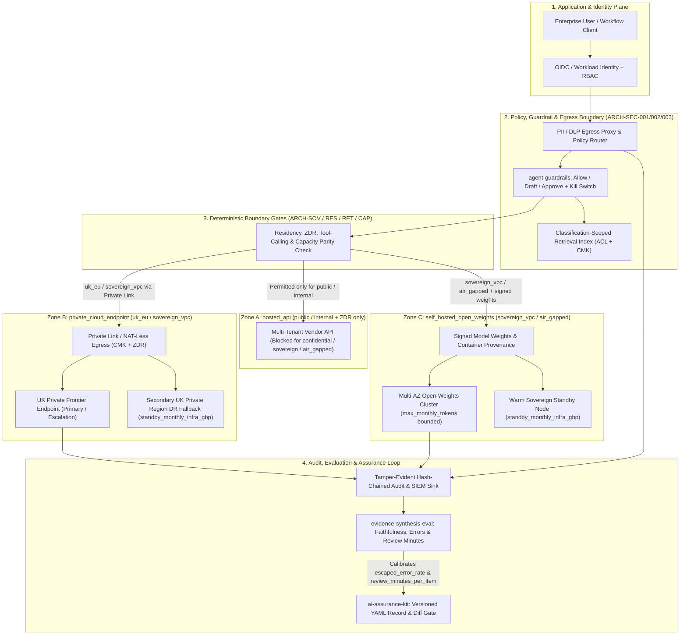
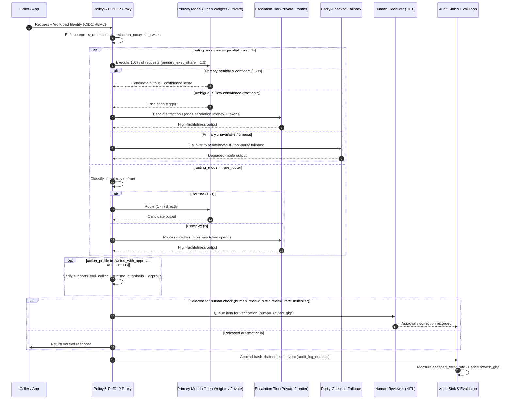

# Reference Architecture Boundaries & Failover Topology

> **Illustrative reference topology.** These diagrams depict the architectural boundaries, security invariants, and routing/failover flows enforced deterministically by `aiarch validate`, `aiarch check`, `aiarch economics`, and `aiarch sensitivity`.

## 1. Deployment & Trust Boundary Topology (Sovereign VPC, Private Link & Air-Gap)

Every routing option in an `ArchitectureBlueprint` is checked across **all participating models** (`primary_model`, `escalation_model`, and `fallback_model`) so that failover under load or outage never silently crosses a weaker residency, retention, or capability perimeter.

## 2. Tiered Cascade, Failover & Human-in-the-Loop Execution Flow

`RoutingOption.routing_mode` explicitly distinguishes a **`sequential_cascade`** (where `primary_model` executes `100%` of requests before escalating fraction `r` to `escalation_model`, incurring `1.0 * primary + r * escalation` token spend and smooth tail-mixture latency) from a **`pre_router`** (where an upfront classifier routes `1 - r` to `primary_model` and `r` directly to `escalation_model`).

